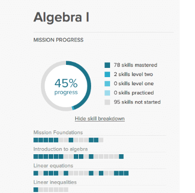

# Levels, progress, and mastery

## Purpose and reference

Use a **Khan Academy-inspired mastery approach**, following the project-specific rules below. This document is the reference for student progress, unit points, and mastery in v0.1 and future units.

The user supplied this image as visual inspiration for showing overall progress and a breakdown of learning statuses:



The image is a visual reference, not an additional set of requirements. Its algebra content, numerical values, colors, and intermediate skill levels are not rules for this application. Keep the project's Clay & Sage palette. No claim is made that this application's scoring matches Khan Academy's actual scoring algorithm.

## Confirmed learning structure

- Each unit will contain approximately **5–7 lessons** for now.
- Each lesson is preceded by its matching vocabulary set and a vocabulary exam with a **75%** pass threshold. This is separate from the unit final exam. See [Vocabulary](vocabulary.md) for the flow and lesson-access interpretation.
- Each unit has a **final exam at the end**.
- Completing a lesson gives that lesson the **Finished** status.
- Finishing all lessons does not grant unit mastery by itself.
- A final exam score of **at least 90%** grants **full mastery** of the unit.
- An exam score below 90% leaves existing progress unchanged and shows **Not mastered yet** for a unit that has not achieved mastery.
- Each unit offers **100 points total**: **50 from finishing lessons** and **50 from the qualifying final exam**.

## Status meanings

Lesson completion and unit mastery are separate concepts.

| Scope | Status | Meaning |
| --- | --- | --- |
| Lesson | Finished | The student has completed this lesson and earned its share of lesson points. |
| Unit | Not mastered yet | The student has not yet achieved at least 90% on the final exam. Lesson progress remains saved. |
| Unit | Mastered | The student has completed the unit's lessons and achieved at least 90% on its final exam. |

When all lessons are finished but the exam has not been passed, show both facts clearly: **Lessons finished · Not mastered yet**.

Labels for lessons that have not been started or are underway can be defined during implementation. No additional numbered levels, XP ranks, or CEFR levels have been requested.

## Points and progress

### Lesson points: up to 50 per unit

Each finished lesson contributes toward a shared **50-point lesson total**. Finishing every lesson earns exactly 50 points, regardless of whether the unit has 5, 6, or 7 lessons.

**Working implementation assumption:** lessons have equal weight within their unit. The user has specified the total but has not requested different weights for individual lessons.

```text
lesson_points = 50 × (finished_lessons / total_lessons)
```

For 5 lessons, each contributes 10 points. For 6 or 7 lessons, keep fractional precision in the calculation and round only for display. Reopening or repeating a finished lesson must not award its points again.

### Final exam points: 0 or 50 per unit

Interpret the requested second half of the points as a mastery award:

| Final exam result | Exam points awarded | Effect on existing progress |
| --- | --- | --- |
| Not attempted | 0 | Keep lesson progress. |
| Below 90% | 0 | Keep existing points and completed lessons; no partial exam points. |
| 90% or above | 50 | Award the remaining 50 points and full unit mastery. |

Award the final exam's 50 points only once. A score of 90% earns the same mastery points as 100%.

```text
unit_points = lesson_points + mastery_exam_points
unit_progress_percent = (unit_points / 100) × 100
```

The final exam follows completion of the unit's lessons. Under this sequence, all lessons finished means **50/100 points**, and a qualifying final exam brings the unit to **100/100 points**.

Keep the **exam score** distinct from **unit progress**. An 85% exam result does not mean 85% unit progress. Do not round an exam score below 90% upward to award mastery.

## Example: a unit with 6 lessons

| Student outcome | Unit points | Unit progress | Mastery status |
| --- | --- | --- | --- |
| No lessons finished, exam not attempted | 0/100 | 0% | Not mastered yet |
| 3 of 6 lessons finished | 25/100 | 25% | Not mastered yet |
| All 6 lessons finished, exam not attempted | 50/100 | 50% | Not mastered yet |
| All 6 lessons finished, exam score 85% | 50/100 | 50% | Not mastered yet |
| All 6 lessons finished, exam score 89.9% | 50/100 | 50% | Not mastered yet |
| All 6 lessons finished, exam score 90% | 100/100 | 100% | Mastered |
| All 6 lessons finished, exam score 100% | 100/100 | 100% | Mastered |

## Student and teacher views

Expose the following information clearly in both student progress views and the teacher dashboard:

- Lessons finished out of total lessons.
- Individual lesson completion statuses.
- Unit points out of 100 and the corresponding progress percentage.
- Final exam result, separately labeled as an exam score.
- Unit mastery status: **Not mastered yet** or **Mastered**.

Persist lesson completion and exam results so progress survives a new visit. A failed exam must not reset completed lessons or previously earned lesson points.

## Remaining decisions

- The exact action or exercise result that marks an individual lesson Finished.
- Final exam questions, question weights, partial credit, and how exam percentages are calculated.
- Retry availability, attempt limits, and any waiting period between attempts.
- Which exam result to display when there are multiple attempts, and how later attempts behave after mastery has already been earned.
- How progress across multiple units is combined in future releases. v0.1 has only Unit 1: To Be.

The 90% mastery threshold and 50/50 unit point split are confirmed requirements, not open decisions.

Vocabulary passing does not itself grant Finished lesson status, final exam points, or unit mastery. No separate vocabulary points have been specified; any future vocabulary point rule must respect the existing unit total. See [Vocabulary](vocabulary.md).
